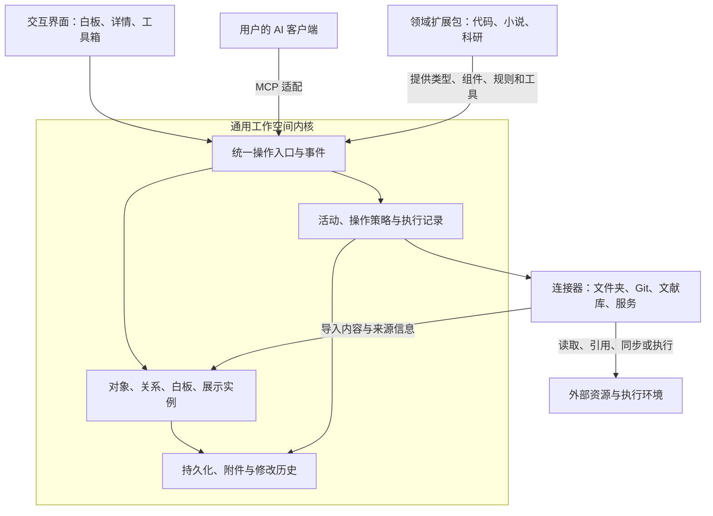

# 通用工作空间内核：契约与迁移映射

依据：[issue #11 架构规划](https://github.com/victorzhong0110/sand-table/issues/11)（2026-10-20 确认）。
状态：**契约已确认，实现分阶段推进**。本文描述目标契约与各阶段当前落地情况，不把规划写成已实现。

本文是 issue #11 的 P0 交付物，并作为 P1–P3 实现的共同规格。术语与类型名以本文为准。

---

## 0. 为什么改

现有实现把「代码仓库投影 + 白板编排」绑在一起：内容入口依赖仓库，组件实例自带内容，
白板只存在于内存（[开发规划 v0.3](../../DEVELOPMENT_PLAN.zh-CN.md) D16），进程退出即清空。

issue #11 要求的方向是 **通用工作空间内核 + 可组合领域扩展包 + 可选外部连接器**：

> 去掉 Git、源码索引和 AI 连接后，Sand Table 是否仍能独立完成工作、保存成果？

这条验收问题决定了本轮所有取舍。Git 与 AI 都从「启动条件」降级为「可选连接器」。

---

## 1. 概念映射（旧模型 → 新模型）

P0 验收要求：开发者无需根据名称猜测「对象是源码还是卡片」，每类状态有唯一权威与生命周期。

| 旧概念 | 位置 | 新概念 | 迁移方式 | 生命周期与权威 |
|---|---|---|---|---|
| `Item`（kind: workspace/file/symbol） | `core/model.ts` | 代码投影对象（读回时映射为 `WorkspaceObject`，kind = `code`） | 保留字段；读回边界统一映射，物理合表随 P4 领域包一起做 | 由代码领域包投影产生，可随源码刷新失效 |
| 组件内联 `data`（便签、代码片段、表格…） | `ComponentInstance.data` | `WorkspaceObject`（kind = `native`）的内容 | 迁移时把实例内联内容提升为独立对象，实例改为绑定 | 原生内容的第一等公民，独立生命周期与版本 |
| `ComponentInstance` | `core/spaces.ts` | `Presentation`（展示实例） | 字段保留，新增 `binding` | 属于白板（空间），随白板持久化；只管布局与呈现 |
| `Space`（`id/title/parentId`） | `core/spaces.ts` | `Board`（白板，特殊对象） | 保留结构，新增 `objectId` | 属于工作空间，可嵌套，禁止循环包含 |
| `SpaceLink` | `core/spaces.ts` | `ObjectRelation`（语义关系） | 保留 `related/depends-on/...` 并扩展 | 属于工作空间，描述对象间语义，与布局无关 |
| `Board`（会话容器，含全部状态） | `core/model.ts` | `Workspace`（持久边界） | 拆为工作空间 + 板 + 对象 | 长期保存，重启不丢；会话只是连接 |
| `Board.expiresAt` + `BoardStore.boards` | `core/store.ts` | `WorkspaceStore`（文件持久化） | 新增持久层，TTL 降级为「闲置回收」 | 文件系统为唯一权威 |
| `Placement`（对象位置） | `core/model.ts` | `Presentation.rect` | 统一到展示实例 | 布局与内容版本分离，互不干扰 |
| `Proposal` / `ChangeIntent` | `core/changes.ts` | 保留，纳入 `Activity` 体系 | 不变 | 外部改动确认链路，**不**套用到每次笔记编辑 |
| `Asset` | `core/spaces.ts` | `ResourceReference` + 附件 | 保留，增加外部引用类型 | 附件随工作空间导出；外部引用可失效 |
| `Activity` / `SpaceActivity` | `core/model.ts` | `Activity`（统一） | 合并两套为一套 | 人或 Agent 的任务与产物 |
| 源码 `Evidence` | `core/model.ts` | `ObjectSource`（来源与依据） | 扩展为人工/导入/AI 生成 + 外部定位 | 记录来源，引用失效必须可识别 |
| —（无） | — | `ObjectRelation.status` | 新增 | 推测性关系不得伪装成已确认事实 |
| —（无） | — | `History`（撤销栈）＋ `AuditLog`（审计） | 新增，两者**不是**同一概念 | 撤销栈可回退；审计只追加 |

> **关于「一张表」**：本轮先做到**读回边界统一**——`sand_list_objects` 同时返回原生内容与代码对象，
> 用 `kind` 区分来源，开发者不必猜「这个对象是源码还是卡片」。物理合表（代码对象真正落进
> `WorkspaceObject` 表）随 P4 的代码领域包一起做，避免同一块代码改两遍。

### 1.1 权威归属（唯一真相）

| 状态 | 唯一权威 | 其他副本 |
|---|---|---|
| 原生内容、代码对象、关系 | 工作空间文件 `workspace.json` | 内存为缓存；MCP 与界面读同一份 |
| 白板布局、选区、相机 | 工作空间文件 | 视图状态是派生缓存 |
| 源码真相 | 目标 Git 工作区实际内容 | 索引快照只是投影，可能过期 |
| 外部写入结果 | 宿主实际文件系统 | 提案确认状态只表达意图与授权 |
| Agent 活动状态 | Agent 自报 + 最近已知时间戳 | 两者必须区分标注 |

---

## 2. 逻辑架构



**部署结构不变**：仍是单个本地应用/进程。上图是职责边界，不是微服务拆分。

**已有实现可复用的关键事实**：界面与 AI 都通过同一组 MCP 工具读写（界面走 `app.callServerTool`，
AI 走 stdio 工具调用），因此「统一操作入口」在结构上已经存在——P3 是在这条既有路径上补
历史、冲突与意图分组，而不是重写一条并行通道。

---

## 3. 数据模型（实现以本文类型为准）

```ts
// 对象来源：人工、导入、AI 生成或推断
export type ObjectSource = {
  origin: "human" | "imported" | "ai-generated" | "ai-inferred" | "code-index";
  author?: string;
  basis?: string;              // 依据说明（推断必须给依据）
  external?: ExternalLocator;  // 外部定位
  importedAt?: number;
  fingerprint?: string;        // 外部内容指纹，用于识别变化
};

// 外部资源定位：整体或具体片段
export type ExternalLocator = {
  kind: "file" | "git" | "pdf" | "url" | "dataset" | "symbol";
  uri: string;                 // 定位标识
  fragment?: string;           // 页码 / 行号 / 符号 / 数据范围
  version?: string;            // 版本或提交
};

// 统一对象：原生内容与代码对象共用一张表
export type WorkspaceObject = {
  id: string;
  kind: "native" | "code" | "reference";
  type: string;                // "note" | "character" | "symbol" | ...
  typeVersion: number;         // 类型版本，用于类型迁移
  title: string;
  body?: string;               // 原生正文
  data?: Record<string, unknown>; // 类型专属载荷
  source?: ObjectSource;
  version: number;             // 对象级版本，冲突检测粒度
  createdAt: number;
  updatedAt: number;
  author: string;
};

// 语义关系：与布局无关
export type ObjectRelation = {
  id: string;
  source: string;              // objectId
  target: string;              // objectId
  kind: string;                // 参与 / 导致 / 先于 / 支持 / 反驳 / 调用 ...
  status: "confirmed" | "inferred";
  attributes?: Record<string, unknown>;
  basis?: string;              // 依据
  evidence?: ExternalLocator[];
  createdAt: number;
  author: string;
};

// 展示实例：只管呈现与布局
export type Presentation = {
  id: string;
  spaceId: string;             // 所属空间（白板内分区 id，如 overview / 子白板空间）
  type: string;                // 组件类型（渲染方式）
  binding?: {
    kind: "object" | "local" | "tool";
    objectId?: string;         // kind=object 时必填
  };
  appearance?: { icon?: string; detail?: "full" | "label" | "icon" };
  title: string;               // 未绑定对象时的本地标题
  data: Record<string, unknown>; // 未绑定对象时的本地内容 / 视图配置
  rect: Rect;
  updatedAt: number;
  author: string;
};
```

**绑定规则（核心不变量）**：

- `binding.kind === "object"` 时，呈现内容来自对象，**不是** `instance.data`。
  `instance.data` 只保存视图级配置。
- 同一对象可以在多个白板有多个展示实例；改内容同时更新所有展示，移动其中一个不影响另一个。
- 「再放一份展示」= 新建展示实例；「复制出独立对象」= 新建对象并复制内容。两者必须区分。
- 「移除展示」≠「删除对象」。对象被多处引用时删除必须显式声明处理方式，不允许静默损坏。

---

## 4. 最小约束（实现前必须成立的不变量）

这些是 P0 验收「每类状态有唯一权威与生命周期」的具体化，也是自动测试的断言目标。

| 编号 | 不变量 | 可验证方式 |
|---|---|---|
| I1 | 对象 ID 全工作空间唯一且稳定；重启后不变 | 持久化往返后 ID 不变 |
| I2 | 同一对象的多个展示实例共享内容、独立布局 | 改对象 → 所有实例变；移一个 → 另一个不动 |
| I3 | 移除展示不删除对象；删除对象时必须处理引用 | 引用计数 + 显式策略 |
| I4 | 白板嵌套无环；白板链接不当作包含 | 构造环路必须被拒绝 |
| I5 | 关系不因位置相近自动建立；推测关系标记为 `inferred` | 位置操作不产生关系 |
| I6 | 语义关系与展示关系分离 | 改关系不改变布局 |
| I7 | 原生内容不依赖仓库存在，可被搜索与读回 | 无 Git 启动时 `sand_list_objects` 仍返回原生对象 |
| I8 | 写后读回返回稳定 ID、结果版本与明确读回路径 | 创建后重查得到同一 ID |
| I9 | 版本冲突被检出，不静默覆盖 | 过期版本写入被拒绝 |
| I10 | 撤销按用户意图分组；连续 Undo/Redo 不震荡；**任意历史记录都可达** | 连续操作序列测试 + 跨分支跳转测试 |
| I11 | 审计记录与撤销栈是两个概念 | 撤销本身也进审计，但撤销栈游标不变 |
| I12 | 白板撤销不冒充外部回滚 | 外部效果不进入撤销栈 |
| I13 | 保存失败必须报错并保留未提交内容，不显示虚假「已保存」 | 注入写失败 |
| I14 | 工作空间格式有版本与迁移路径；迁移失败不静默丢弃 | 旧版本文件迁移测试 |
| I15 | 引用失效、外部内容更新可识别，不静默覆盖 | 指纹比对 |

**I16（2026-10-20 集成轮补充）**：板级内容（嵌套白板、空间关系、分组、布局锚点、
组件包、主题）与对象/展示/关系一样，必须可撤销，且按**键**记录——
撤销一次组件包导入不应连带回滚并发发生的主题修改。
实现见 `core/objects.ts` 的 `BoardStateKey` 与 `EntitySnapshot.target = "board"`；
规格与取舍见 `docs/architecture/integration-2026-10.zh-CN.md` 决策 D2。

**I17–I22（2026-10-20 收尾轮补充）**

| 编号 | 不变量 | 可验证方式 |
|---|---|---|
| I17 | 同一工作空间同一时刻只有一个写者；跨进程并发写不得静默覆盖 | 两个锁实例竞争 + 注入写失败 |
| I18 | 工作空间之间互相隔离；切换前先落盘当前内容，切换失败不留下半切状态 | 切换往返测试 |
| I19 | 领域语义不硬编码进内核：类型、组件、关系、工具、模板来自**注册表** | 架构测试：内核不含领域词 |
| I20 | 连接器显式声明能力；未声明的能力被调用时拒绝并说明原因 | 只读连接器写入被拒 |
| I21 | 白板内 AI 入口按宿主**真实能力**显示；只有 MCP 时不提供假入口 | 能力探测单测 + UI 快照 |
| I22 | 领域包与连接器可整体禁用，内核仍能启动、建对象、编辑、保存、重开 | 关闭全部包的集成测试 |

**历史模型的选择（2026-10-20 集成轮）**：撤销单位是**用户意图**（`intentId` 分组），
不是「一次写入」；快照是**实体级**的（object / presentation / relation / board 键），
不是整块白板。理由与被否决的替代方案见
`docs/architecture/integration-2026-10.zh-CN.md` 决策 D1。

**实现状态（2026-10-20 交叉审计后核对）**：I1–I14 已落地并有自动化用例覆盖；
**I15 尚未实现**——`ResourceReference.status` 的 `stale` / `missing` 与 `ObjectSource.fingerprint`
目前都没有计算方（没有比对入口），属于 P4 连接器范围，见 issue #13。
本文不把它算作已完成，也不允许接线层假装它成立。

---

## 5. 存储与生命周期

### 5.1 落盘格式

> 结构对应（接线时别猜）：`objects` 与 `relations` 在文件**顶层**；展示实例在
> `boards[0].presentations`。纯函数层 `core/content.ts` 的 `ObjectState` 是一块**扁平**结构，
> 不能当成文件的某一段直接铺回去——那会让被删的展示实例在重启后复活。
> `core/workspace.ts` 的 `readObjectState()` / `writeObjectState()` 给出显式映射。

```text
<root>/
  <workspaceId>/
    workspace.json      # 权威状态
    attachments/        # 附件二进制
```

- `root` 默认 `process.env.SAND_WORKSPACE_DIR || ~/.sand-table/workspaces`。
- `workspace.json` 原子写：先写 `.tmp`，`fsync` 后 `rename` 覆盖。崩溃不留半截文件。
- 保留上一份 `workspace.json.bak`；主文件解析失败时回退并显式告警，不静默丢弃。

### 5.2 会话与工作空间分离

- **工作空间**：长期作品，文件持久化，重启不丢。
- **会话**：MCP 连接、认证、视图会话等临时状态。连接断开不删除作品。
- 白板属于工作空间；Agent 运行环境关联工作空间中的对象或活动，不等于工作空间。
- 闲置回收只清理「未持久化或已明确结束」的板子，不能连带删除工作空间文件。

### 5.3 导出与导入

- 导出为自包含 JSON 包：对象、关系、白板、展示实例、活动与必要历史；附件按需内联或列出。
- 外部依赖（Git 仓库、URL、文献库）必须在导出包中显式声明，导入时提示「引用未随包迁移」。
- 导入不静默覆盖同 ID 工作空间；冲突要求显式选择。

---

## 6. 命令、历史与冲突

### 6.1 统一入口

界面与 Agent 走同一套命令与校验。命令结果统一返回：

```ts
{ ok: true, id: string, version: number, revision: number, readBack: string }
```

`readBack` 给出明确的读回路径，避免 Agent 因查询口径错误重复创建。

### 6.2 版本与冲突

- 布局版本（`revision`）与内容版本（对象级 `version`）分离：拖动组件不与内容编辑互相冲突。
- 内容写入携带 `expectedVersion`；不匹配时拒绝并返回当前版本，不静默覆盖。
- 失败重试需要显式幂等键，不能默认再次创建。

### 6.3 撤销、重做与审计

- 撤销单位是**用户意图**：一次拖动、一次连续输入、一批同意图的 Agent 修改算一个撤销单位。
- 历史是**分支时间线**，不是两个栈（2026-10-20 收尾轮改写，取代此前的双栈描述）：
  每条记录带 `parentId`，另有一个游标表示当前板面位置。
  Undo 把游标移到父节点，Redo 移到子节点；**新编辑从游标分叉，旧分支保留**。
  因此被新编辑「覆盖」掉的旧历史**仍然可达**——这正是双栈做不到的地方
  （双栈会在新编辑时清空重做栈，那段历史从此消失）。
  连续 Cmd+Z 在同一步的撤销与恢复之间**不得**来回震荡。
  规格见 `docs/architecture/history-timeline.zh-CN.md`。
- 审计日志只追加，记录执行者与动作（含「执行了撤销」），与撤销栈游标无关。
- 白板撤销不声称撤回已发布的 PR、已运行的实验或已发送的内容。
- 外部效果的回滚属于补偿操作，不进入白板撤销栈。
- 撤销补丁**只有一种形状**：`target: "batch"`，`before` / `after` 都是实体快照数组
  （`{ target, id, value }`，`value: null` 表示该实体在此刻不存在）。
  单目标形状不被接受：它会被内核静默忽略，造成「撤销报成功、实际什么都没回退」。
- 每条撤销条目必须声明动作种类（`kind`）。种类是「这条能不能进白板撤销栈」的判别依据
  （I12），也是落盘后仍然可判的依据——写盘时不得丢弃它。
- 绑定判定只有一处：展示实例绑定到哪个对象，统一由 `core/content.ts` 的 `boundId()` 判定。
  删除、引用检查、撤销快照必须用同一个判定，否则会出现「删掉了却撤不回来」。

### 6.4 按操作影响处理

| 操作 | 默认体验 |
|---|---|
| 移动、折叠、调整展示 | 即时生效，可撤销 |
| 编辑原生内容 | 自动保存，记录历史，可撤销 |
| 导入外部材料 | 明确范围，保留来源 |
| 修改外部文件、运行任务、发布内容 | 连接器声明影响，按授权策略执行，必要时确认 |

「明确意图 → 具体提案版本与 digest → 人确认 → 宿主写入 → 实际内容与范围核验」**只**用于代码外部改动，
不套用到每一次笔记编辑，也不得因架构通用化而削弱既有源码写入确认边界。

---

## 7. 阶段状态

| 阶段 | 内容 | 状态 |
|---|---|---|
| P0 | 契约与迁移映射（本文） | ✅ 已交付 |
| P1 | 独立于 Git 的持久工作空间 | ✅ 存储层与启动路径已落地（`core/workspace.ts`、`core/persistence.ts`）；导出／导入与工作空间选择器待补 |
| P2 | 对象、关系与展示实例分离 | ✅ 原生内容、语义关系、展示实例已分离（`core/content.ts` + 接线）；代码对象物理合表随 P4 做 |
| P3 | 统一操作与历史 | ✅ 按意图分组的撤销／重做与独立审计已落地（`core/history.ts` + 接线）；UI 与 AI 走同一入口已成立 |
| P4 | 代码领域包与连接器抽出 | ⏳ 见 issue #13 |
| P5 | 小说与科研最小纵向验证 | ⏳ 见 issue #14 |
| P6 | 发布与真人验收 | ⏳ 见 issue #15 |

issue #11 保持为总入口。P4–P6 已拆为独立 issue（#13 / #14 / #15），写清依赖、范围、迁移影响与可验证完成条件。

### 7.1 本轮落地的代码位置

| 关注点 | 位置 |
|---|---|
| 共享类型（对象／关系／展示／历史／审计） | `workbench/core/objects.ts` |
| 对象与展示实例的纯函数层 | `workbench/core/content.ts` |
| 撤销栈与审计日志 | `workbench/core/history.ts` |
| 工作空间文件存储、迁移、导出导入 | `workbench/core/workspace.ts` |
| 存储层与内核的接线 | `workbench/core/persistence.ts` |
| 内核的原生内容、语义关系、撤销／重做 | `workbench/core/store.ts` |
| 白板操作（present / copyObject / deleteObject / relate / undo / redo） | `workbench/server/spaces.ts` |
| AI 侧工具面 | `workbench/server/server.ts`（`sand_list_objects`、`sand_read_object`、`sand_undo`、`sand_redo`、`sand_workspace_status`） |
| 启动与工作空间目录 | `workbench/server/main.ts`、`workbench/local/main.ts`（`--workspace-dir` / `--workspace-id`） |
| 集成测试 | `workbench/tests/kernel.test.ts` |
